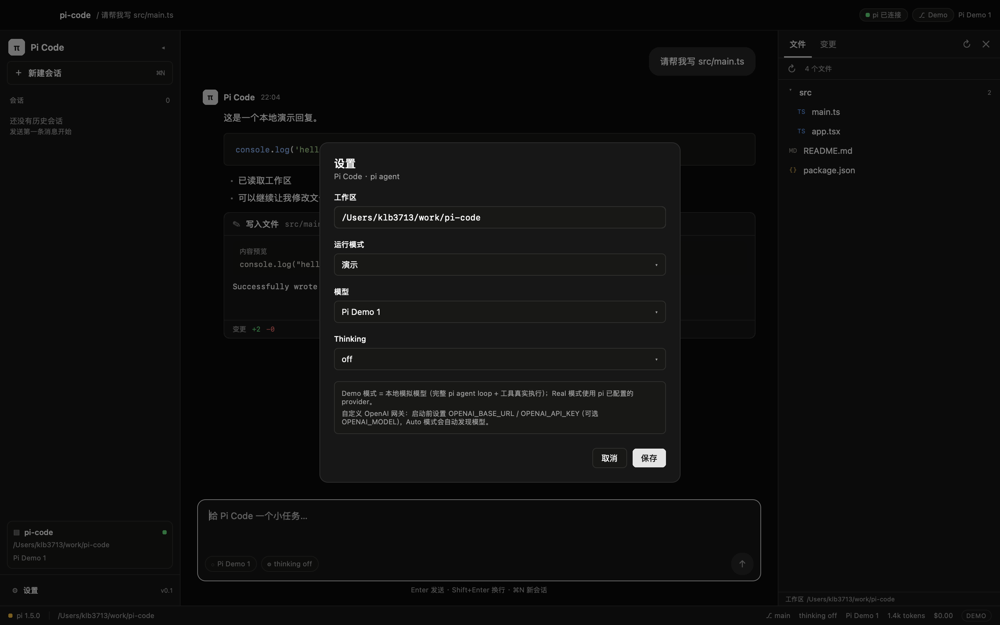
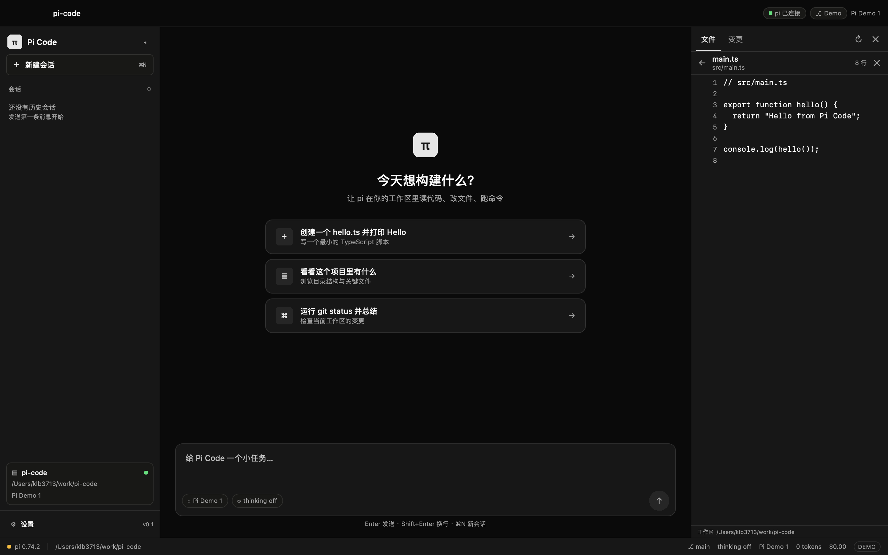

# Pi Code

> 一个 Claude Code 桌面版风格的 AI coding 应用：**nsh** 原生界面 + **pi** agent 运行时。

Pi Code 用 [pi](https://github.com/earendil-works/pi)（`@earendil-works/pi-coding-agent` 1.5.0）作为 AI coding agent 内核，用 [nsh](https://nsh.dev/zh-CN/docs/) 的 TSX 原生 UI 构建桌面界面。pi 以 `--mode rpc` 子进程运行完整的 agent loop（read / write / edit / bash / grep / find 工具、流式输出、会话持久化、上下文压缩），nsh 应用通过一个本地 Node bridge 与它通信。


## 功能（v1）

- **流式对话**：Markdown 渲染、代码块（复制按钮）、thinking 折叠、停止生成、错误提示。
- **工具调用可视化**：工具卡片显示 read/write/edit/bash 等调用的目标、运行状态、耗时、可展开输出，write/edit 带变更统计。
- **工作区文件树**：右侧 Files 面板浏览、展开目录、打开只读文件预览（行号 + 等宽字体）。
- **变更与 Diff**：Changes 面板汇总本次会话/git 变更，点击用 `DiffView` 查看 unified diff。
- **会话管理**：新建会话、最近会话列表、切换历史会话（读取 pi session 文件）。
- **模型与设置**：模型选择、thinking level、工作区路径、运行模式（auto / demo / real）。
- **桌面体验**：自定义标题栏（macOS 红绿灯内嵌）、三栏布局、状态栏（模型 / token / 成本 / 分支）、⌘N / ⌘, / ⌘B 快捷键。
- **Demo 模式**：没有配置真实 provider 时自动启动本地 OpenAI-compatible Mock LLM——**pi 的 agent loop 与工具执行仍然是真实的**，只有模型回复由本地脚本生成，便于开箱即用与端到端测试。

| 欢迎页 | 设置 |
| --- | --- |
|  |  |

| 文件预览 | 变更 Diff |
| --- | --- |
|  |  |

## 快速开始

环境要求：macOS 14+（nsh 桌面）、Node.js **>= 22.19**（pi 1.5.0 的最低版本，推荐当前 LTS）、`nsh` CLI 0.4+（`nsh --version` 验证）。

```bash
# 1. 安装 bridge 依赖（pi 1.5.0）并生成本机路径配置
npm run setup

# 2. 启动桌面应用（nsh 热更新）
nsh run App.tsx
# 或 npm run dev

# 3. 运行测试
npm test          # nsh test
node server/test-bridge.mjs   # bridge 独立端到端测试
```

首次启动会连接本地 bridge：如果 pi 没有可用模型，会自动进入 **Demo 模式**，可以直接输入「创建一个 hello.ts 并打印 Hello」体验真实工具调用与文件变更。

### 使用自定义 OpenAI 兼容网关（推荐）

Pi Code 支持任意 OpenAI 兼容网关。bridge 会读取 `OPENAI_BASE_URL`，自动请求 `${OPENAI_BASE_URL}/models`，把返回的模型注册为 pi 的 `openai-gateway` provider：

```bash
export OPENAI_BASE_URL=http://127.0.0.1:3425/v1
export OPENAI_API_KEY=your-api-key
# 可选：指定默认模型；不设置时使用 /models 返回的第一个模型
export OPENAI_MODEL=auto/glm-5.3
nsh run App.tsx
```

启动后状态栏会显示 `LIVE`，模型 chip 显示网关模型名（例如 `GLM-5.3`）；设置里的「模型」下拉会列出网关返回的全部模型。`OPENAI_BASE_URL` / `OPENAI_API_KEY` / `OPENAI_MODEL` 都已在 `nsh.json` 的 process capabilities 中授权。

如果网关不可用：`auto` 模式会回退 Demo；`real` 模式会显示明确错误。

### 使用其他 pi provider

Pi Code 也复用 pi 的原生 provider 配置。可以设置 `ANTHROPIC_API_KEY`、`OPENAI_API_KEY` 等环境变量，或在 `~/.pi/agent/auth.json` 中持久化（由 pi CLI 的 `/login` 生成）。启动后在设置里把运行模式切到「真实」；「自动」模式会优先使用可用模型，否则回退 Demo。

## 架构

```
┌────────────────────────────── nsh 原生窗口 ──────────────────────────────┐
│  App.tsx / app/**（TSX + signals + Tailwind 4）                          │
│  TitleBar · Sidebar · ChatView · Composer · RightPanel · Settings         │
│        │  store.ts（signals / actions / 事件归约）                        │
│        │  bridge-client.ts（JSONL over stdio）                            │
└────────┼─────────────────────────────────────────────────────────────────┘
         │ process.spawn("node", server/bridge.mjs)
┌────────▼──────────────────── server/bridge.mjs ──────────────────────────┐
│  init / prompt / abort / new_session / list_files / read_file /          │
│  git_status / get_diff ...（docs/SPEC.md §3 协议）                        │
│        │ spawn(process.execPath, pi --mode rpc --session-dir ...)        │
│        ▼                                                                 │
│  pi 1.5.0 agent loop（工具执行、会话、压缩、流式事件）                    │
│        │ OpenAI-compatible                                              │
│        ▼                                                                 │
│  真实 provider  ··· 或 ···  server/mock-llm.mjs（Demo 模式）              │
└──────────────────────────────────────────────────────────────────────────┘
```

- **UI 与运行时解耦**：nsh 应用只依赖 `app/protocol.ts` 定义的 JSONL 协议，不直接依赖 pi 的 API；bridge 可以独立测试（`server/test-bridge.mjs`）。
- **Demo 仍是真实 agent**：Demo 模式让 pi 指向本地 mock LLM，工具调用、文件写入、会话记录全部由 pi 真实执行。
- **安全边界**：nsh 的 `capabilities` 只授权 `process.execute: ["node"]` 与工作区所需文件读写；pi 子进程以当前用户权限运行（与 Claude Code / pi CLI 的本地 agent 模型一致）。

更多细节见 [docs/SPEC.md](docs/SPEC.md)（协议、状态机、视觉规范、nsh 使用约定）。

## 目录结构

```
App.tsx                 入口：mount(App)
app/
  App.tsx               根组件（标题栏 / 三栏布局 / 快捷键）
  protocol.ts           bridge JSONL 协议类型
  store.ts              全局 signals、事件归约、actions
  bridge-client.ts      nsh 侧 bridge 子进程客户端
  components/
    shell/              TitleBar / Sidebar / StatusBar
    chat/               ChatView / MessageRow / ToolCard / Composer / Welcome
    panels/             RightPanel / FilesPanel / ChangesPanel / FilePreview / DiffPreview / SettingsDialog
  lib/format.ts         格式化工具
server/
  bridge.mjs            JSONL 请求分发 + 生命周期
  pi-session.mjs        pi RPC 子进程封装与事件归一化
  mock-llm.mjs          OpenAI-compatible Demo 模型（SSE）
  workspace.mjs         文件树 / 读取 / git / diff
  test-bridge.mjs       bridge 端到端自测（11 项）
scripts/setup.mjs       安装 server 依赖、生成本机路径
tests/                  nsh 测试（fake transport + 真实 e2e）
theme.json              Claude 风格深色主题 tokens
nsh.json                nsh 应用配置、Tailwind 扩展、capabilities
```

## 开发路线图

**v1（已完成）**
1. 调研 nsh / pi 能力，确定「nsh UI + Node bridge + pi RPC + 本地 Demo 模型」架构。
2. 工程基础：主题、协议、store、bridge client、应用骨架。
3. Bridge：pi RPC 接入、Demo LLM、workspace/git/diff API。
4. 聊天界面：消息流、Markdown、工具卡片、Composer。
5. 侧边栏、文件树、变更/Diff、设置。
6. 集成、nsh 测试、真实 pi e2e、视觉验收。

**版本升级**

- pi 从 0.74.2 升级到 **1.5.0**（Node ≥ 22.19）：采用 `agent_settled` 作为一次 run 的真正结束（自动重试/压缩/排队不再让 UI 提前变空闲），工具耗时改用 pi 上报的 `durationMs`，停止时先清空排队消息再中止，并新增 bridge `get_state` 命令。

**后续可做**
- 工具权限确认（write/bash 审批）、计划模式、多文件 diff 审阅。
- 终端面板、@ 文件引用、图片/附件输入。
- 会话分支/恢复、成本面板、项目多开。
- `nsh package --target macos` 打包与签名、Windows/Linux 验证。

## 已知限制

- Desktop-first：当前主要验证 macOS；nsh 可跨平台，但 Windows/Linux 未验证。
- 文件预览最多渲染 400 行；大文件读取截断 64KB。
- 变更面板为平铺列表；diff 依赖 git（非 git 工作区对未跟踪文件显示全文）。
- Demo 模型是固定脚本回复，仅用于演示/测试，不代表真实模型能力。
